# tenant-ec2

An install kit for a knowledge host with an agent on AWS, behind a Microsoft Entra sign-in.
A variant selects the complete host design; [compare the variants](docs/variants.md) before installation.
The default `homelab` variant runs on Amazon Linux 2023 x86_64. A conditional `macos` variant runs on an EC2 Mac Dedicated Host.
CloudFormation makes the host, its network, its storage and its identity.
Docker Compose runs the services from the tags and commits in [kits.lock](kits.lock).

The core needs an AWS account, a Microsoft Entra tenant and a domain name.
It needs no home lab, Copilot account or DNS provider key.

Open [the interactive version of this view](docs/aws-core.html) in a browser from the file system. Its notes list cost, public access, data and keys.
Two more AWS views show [shared memory from your terminal](docs/aws-memory.html) and [the Mac variant](docs/aws-mac.html).
The [architecture page](docs/architecture.md) explains the colours, the frames, the detailed diagrams and the [interactive page](docs/architecture.html) of the five diagrams.

## At a glance

| Question | Answer |
| --- | --- |
| What do I open? | `https://ok.<domain>`: OpenKnowledge, after a Microsoft Entra sign-in and the group rule. |
| What is public? | Only `ok.<domain>`, on ports 80 and 443, by default. SSH answers only the `AdminCidr` range. |
| What costs money? | The hours of the EC2 instance, the EBS and EFS storage, the public IPv4 address, the Secrets Manager secret and the Bedrock requests. Options add an S3 bucket, snapshots, logs and a billing alarm. |
| Where is my data? | EBS holds the local databases. EFS holds the OpenKnowledge pages, the OpenViking data and the shared files. |
| Which keys exist? | The host has no AWS key: its instance role gives it AWS access. The provisioner key stays on the administrator machine. |
| How do people share memory? | An administrator deploys one [memory stack](docs/memory-stack.md) for each stage. Each person gets one key and uses Pi or Claude Code in a terminal. |

Warning: a deploy creates billed AWS resources. The Mac variant bills its Dedicated Host for 24 hours at least.

## The core

This core and the quick path describe `homelab`.
The Mac design uses four services, Podman and an operator tunnel, with no public edge or OpenViking.
Its agent remains disabled until the compatible AgentCore kit release and shared pin exist.
Not verified: the Mac runtime on the selected EC2 AMI; source checks do not qualify it.

| Part | Content |
| --- | --- |
| AWS | The provisioner, host-role boundary, VPC, security groups, EC2 instance, Elastic IP, EBS data volume, EFS access points and Secrets Manager secret. |
| Gateway | LiteLLM and Postgres, with `bedrock/luna` at `xhigh` and `bedrock/embed`. The instance role supplies the AWS credential. |
| Memory | OpenViking, with embeddings and vision through the gateway. |
| Knowledge | OpenKnowledge behind the Microsoft Entra ID gate. |
| Agent | A basic pi-durable agent, with OpenViking memory and OpenKnowledge. No web search or desktop part. |
| Core edge | Caddy on ports 80 and 443, with a certificate for each selected name. Only `ok` is public by default. |
| Security review | `/security-review` gives suggestions. It does not block the install. The secret scan remains a gate. |

## The options

An option stays off until you select it. Do not edit a Compose file to select an option.

Separate [memory stacks](docs/memory-stack.md) give each stage its own AgentCore memory, file bucket and people; an administrator deploys them.

| Option | Switch | Page |
| --- | --- | --- |
| Pangolin edge | Add `pangolin` to `EC2_OPTIONS`. It replaces the core edge and needs `EC2_DNS_PROVIDER=porkbun` or `cloudflare`. | [Pangolin](docs/options/pangolin.md) |
| Copilot model routes | Add `copilot` to `EC2_OPTIONS`. | [Copilot](docs/options/copilot.md) |
| DNS provider | Set `EC2_DNS_PROVIDER` to `manual`, `porkbun`, `route53` or `cloudflare`. The default is `manual`. | [DNS](docs/options/dns.md) |
| Home lab tools | Optional Newt site, web search, credential stores and private kit sources. | [Home lab](docs/options/home-lab.md) |

## Quick path

Follow the [install guide](docs/install.md) for the commands and checks.

1. Clone a portable snapshot at its tag. Install and check the Git hooks.
2. Prepare the provisioner. Its key stays off the host.
3. Fill the environment file. Register the Entra application and its group gate.
4. Write the Secrets Manager secret. The first boot reads it.
5. Deploy the stack after approval. Set the DNS record to the Elastic IP.
6. Wait for the bootstrap. Run the checks and complete the first login.
7. Run the advisory security review. Review each suggestion before public use.

Warning: a deploy creates billed AWS resources. No command on this page authorizes a deploy.

Not verified: a complete live install of the core. The reference pages keep the specific limits of the checks.
The lock pins pi-durable at `portable-v0.1.0`; the bootstrap includes the agent, and `verify` requires its running service.
Its source is private. Set `EC2_KIT_TOKEN_PI_DURABLE` as the [private kit source procedure](docs/options/home-lab.md#private-kit-source) describes.
Do not deploy when a required kit has no pin in the lock.
Not verified: a private agent-kit clone or a complete install with the agent on the host.

## Pages

| Page | Content |
| --- | --- |
| [Variants](docs/variants.md) | Linux and Mac comparison, conditional install, accounts, tunnels, costs and release. |
| [Mac host templates](docs/reference/host-template-macos.md) | Allocation/runtime ownership, parameters, outputs and guards. |
| [Install](docs/install.md) | The homelab core install, in order. |
| [Architecture](docs/architecture.md) | The three AWS views, the step view of the shared memory, five detailed diagrams with their Excalidraw scenes, and the interactive page. |
| [Memory stacks](docs/memory-stack.md) | Stage files, people, access rules, keys and the administrator flow. |
| [Memory template](docs/reference/memory-template.md) | The generated resources, parameters and deploy commands. |
| [Entra gate](docs/entra.md) | The application registration, group rule and login checks. |
| [Options](docs/options/README.md) | The switches and the option pages. |
| [Host template](docs/reference/host-template.md) | The AWS components, parameters and storage rules. |
| [Compose stack](docs/reference/compose-stack.md) | The services, file sets, networks and model routes. |
| [Host boot](docs/reference/host-boot.md) | The user data, bootstrap, generated keys and repeat runs; [move to a later snapshot](docs/reference/host-snapshot-move.md). |
| [Deploy script](docs/reference/deploy-script.md) | Commands, update guards and known limits. |
| [Mac runtime](config/macos/README.md) | The Mac bootstrap boundary, account and disk checks, Podman lifecycle, credential bridge and gate. |
| [DNS migration](docs/reference/dns-migration.md) | The move of the DNS zone of a domain to Porkbun, with each record, before the Pangolin certificate. |
| [Host domain move](docs/reference/host-domain-move.md) | The move of the running host under a new domain subtree, with each check and each way back. |
| [Checks](docs/reference/checks.md) | Source checks, dry runs, local gate tests, diagrams and hook behavior. |
| [Credentials](docs/credentials.md) | The names, stores and provisioner procedure. |
| [Security review](docs/security-review.md) | The advisory review and the public risk list. |
| [Glossary](GLOSSARY.md) | The words of the install kit. |
| [Branches](docs/branches.md) | The development branch and portable snapshots. |
| [Remotes](docs/remotes.md) | What each remote receives. |
| [Publishing](docs/publishing.md) | The portable snapshot procedure. |
| [Secret handling](docs/secret-handling.md) | The scan, hooks and deny lists. |
| [Agent rules](AGENTS.md) | Rules for an agent in this repository. |
| [Issue tracker](docs/agents/issue-tracker.md) | The development work contract, not an install step. |
| [Kit lock](kits.lock) | The pinned kit sources, builds and checks. |

The private development checkout holds the original requests and planning record.
The detailed security register stays in the private development checkout.
