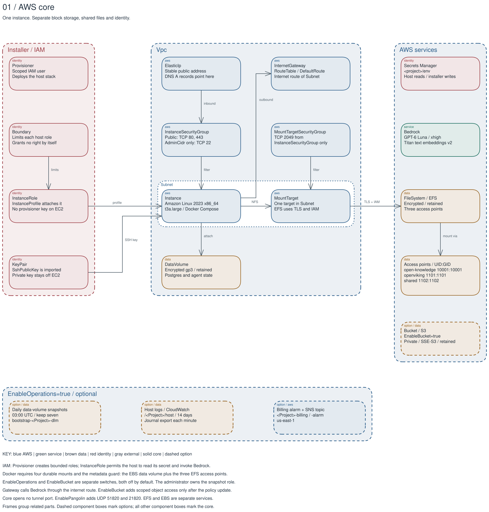
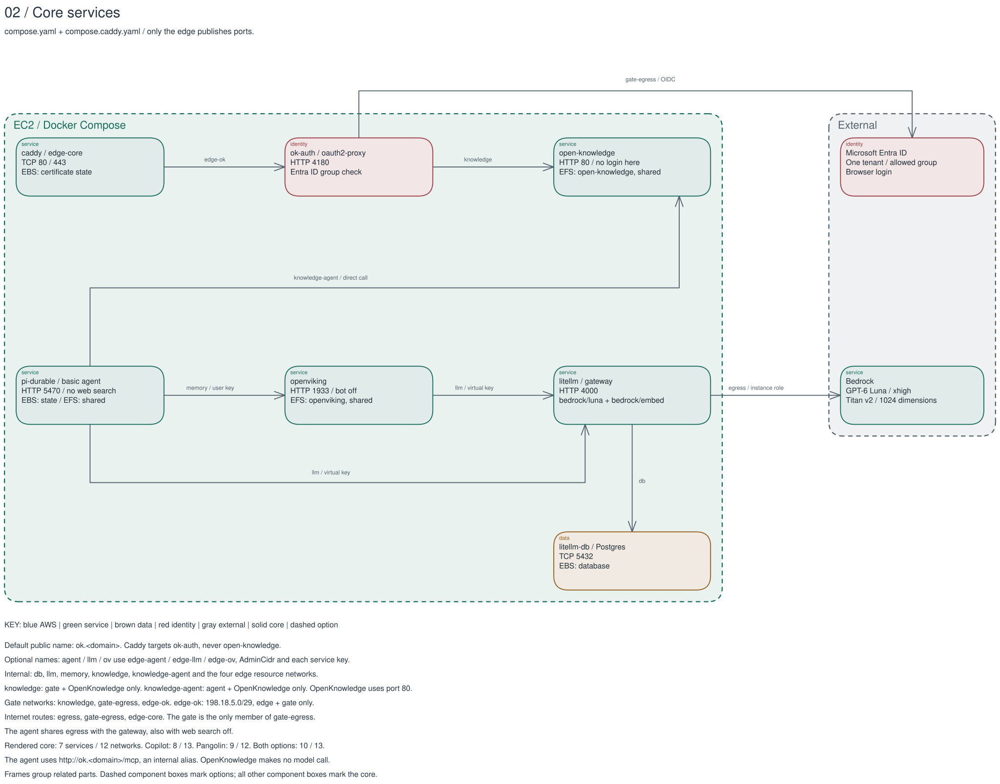
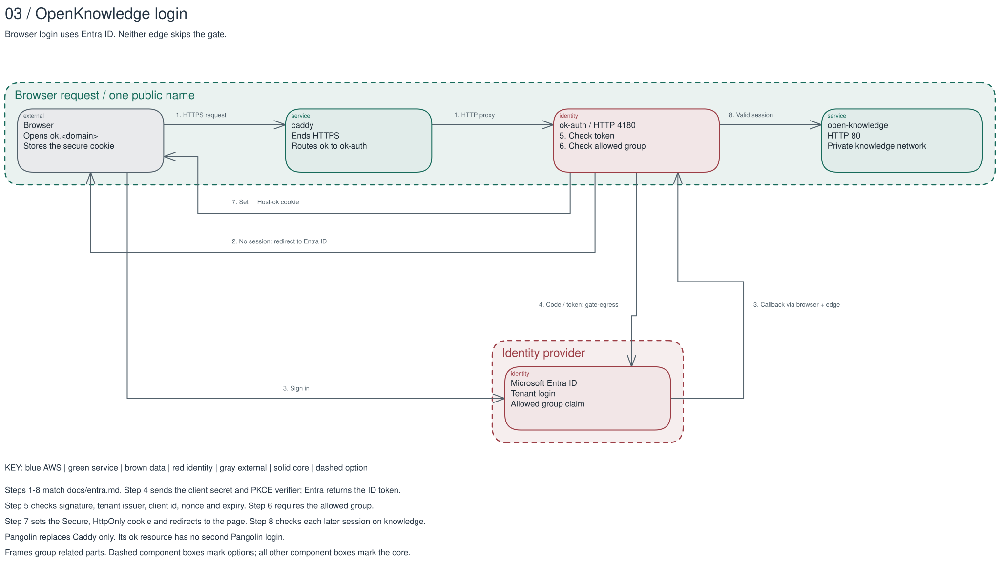
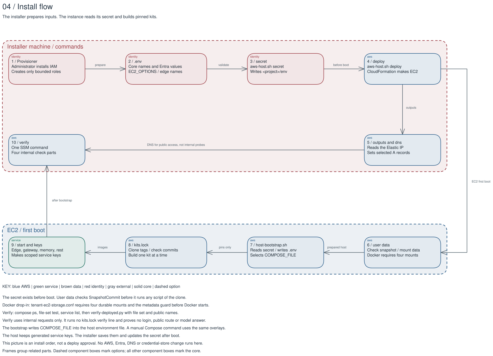
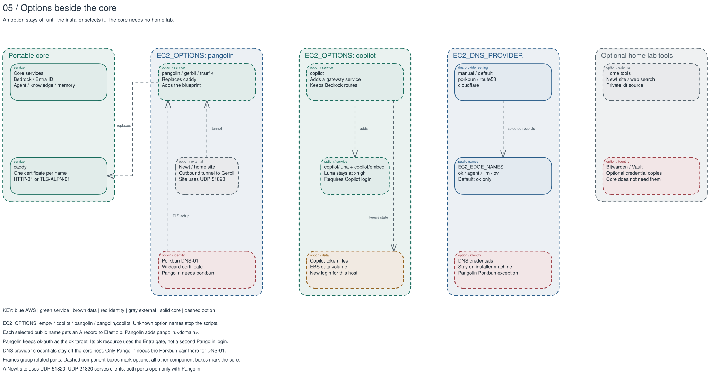

# Architecture

The diagrams show the portable core and its options, not a deployed host.
Each image has an editable Excalidraw scene and a reviewed JSON source beside it.
Arrows show requests or dependencies; frames group related parts.

The colour key stays the same across the five diagrams.
A solid component box marks the core, and a dashed component box marks an option.

| Colour | Part |
| --- | --- |
| Blue | AWS infrastructure |
| Green | Service |
| Brown | Stored data |
| Red | Identity or credential |
| Gray | External client or tool |

## Interactive page

[Open the interactive page](architecture.html) in a browser.
It shows the five diagrams as one graph with the same colour key.
The page is one file, and it makes no network request, so it also works from the file system.

- The left sidebar searches the labels and summaries, filters by diagram and by colour, and shows the legend.
- A click on a part selects it. The right panel shows its summary, its diagrams and its edges.
- A guided tour steps through each diagram with a text for each step. The arrow keys move through the tour.
- The path finder shows the shortest path between two parts.
- Drag the canvas to pan it, and use the mouse wheel to zoom. Escape clears the selection.
- A part out of focus fades its card but keeps a readable label.
- On a narrow screen, the Menu button opens and closes the sidebar over the canvas. Escape also closes the open sidebar.

The source of the graph is [architecture-graph.json](diagrams/architecture-graph.json).
It holds the parts, the edges, the frames and the five tours, with the source files of each part.
Edit the source, not the page. Then build the page, and check the source and the page:

```sh
python3 -I scripts/build-architecture-html.py
python3 -I scripts/build-architecture-html.py --check
python3 -I scripts/build-architecture-html.py --selftest
```

The build needs Python 3.10 or later and no other tool, and it makes no network call.
Two builds of the same source give the same bytes.
`--check` builds the page in memory and compares it with the committed page.
Its last line must start with `architecture: ok`.
The check script runs `--check` and `--selftest` as two of its lines.

- Not verified: the page in a browser other than Chromium.

## AWS core



[Edit the scene](diagrams/01-aws-core.excalidraw) / [Read the source](diagrams/01-aws-core.json)

The provisioner creates the host stack and gives each host role the permissions boundary.
One public subnet holds the instance and the EFS mount target.
The host security group accepts public TCP ports 80 and 443, and SSH from `AdminCidr` only.
The EFS security group accepts TCP port 2049 from the host security group only.
The encrypted EBS data volume holds local databases; EFS provides the `open-knowledge`, `openviking` and `shared` access points.
The instance role reads the stack secret and calls Bedrock; `EnableBucket` optionally adds a private, encrypted S3 bucket.
The access points enforce `10001:10001` for OpenKnowledge, `1101:1101` for OpenViking and `1102:1102` for shared files.
`EnableOperations` separately adds daily data-volume snapshots, host logs and a billing alarm with its topic.
The administrator owns the snapshot role `bootstrap-<Project>-dlm`; the provisioner cannot change that role.

## Core services



[Edit the scene](diagrams/02-services.excalidraw) / [Read the source](diagrams/02-services.json)

The core uses `compose.yaml` with `compose.caddy.yaml`, and only `caddy` publishes ports.
The default public name, `ok.<domain>`, targets `ok-auth`; the gate sends allowed browser requests to `open-knowledge` on `knowledge`.
The basic `pi-durable` agent reaches OpenKnowledge directly on `knowledge-agent`, not through the gate; its OpenViking calls use `memory` and a user key.
The agent and OpenViking call `litellm` on `llm` with separate virtual keys; the gateway reaches Postgres on `db`.
The gateway uses the instance role for `bedrock/luna` at `xhigh` and `bedrock/embed`; its outbound calls use `egress`.
The gate reaches Microsoft Entra ID on `gate-egress`, where it is the only member.
OpenKnowledge listens on port 80; `edge-ok` uses the trusted range `198.18.5.0/29` with only the edge and gate.
The complete core has seven services and twelve networks; three networks have an internet route: `egress`, `gate-egress` and `edge-core`.
The cards name each store; optional public names use `edge-agent`, `edge-llm` and `edge-ov` with the admin range and service keys.

## Entra login



[Edit the scene](diagrams/03-entra-login.excalidraw) / [Read the source](diagrams/03-entra-login.json)

The browser opens `ok.<domain>`, and Caddy sends the request to `ok-auth` on HTTP port 4180.
Without a session, the gate sends the browser to Microsoft Entra ID.
Entra returns the authorization code through the browser to `/oauth2/callback` on the same public name.
The gate exchanges the code, checks the tenant and allowed group, and sets a secure session cookie.
Only an allowed session reaches OpenKnowledge; later browser requests still pass through the gate.
The Pangolin option replaces Caddy, not the Entra gate, and adds no second login to the `ok` resource.

## Install flow



[Edit the scene](diagrams/04-install-flow.excalidraw) / [Read the source](diagrams/04-install-flow.json)

An administrator prepares the provisioner and boundary before the installer sets the core and Entra names in `.env`.
The installer writes the Secrets Manager secret before deployment, because the first boot reads it.
The deploy makes the instance and Elastic IP; the DNS step sets the selected names while the host boots.
User data checks the snapshot commit, installs the host tools and mounts the EBS data volume and EFS access points.
The Docker systemd drop-in requires all four durable mounts and the metadata guard before Docker starts.
The bootstrap reads the secret, selects `COMPOSE_FILE`, builds the kit tags of `kits.lock`, starts the services and makes scoped service keys.
After the bootstrap, `scripts/aws-host.sh verify` sends one SSM command with four parts.
They are `docker compose ps`, the file-set test, the service list and `scripts/verify-deployed.py` with the file set and public names.
The host probes use internal endpoints only; they run no `kits.lock` verify line and prove no public route.
DNS remains necessary for public access and certificates, not for the verifier's internal requests.

## Options



[Edit the scene](diagrams/05-options.excalidraw) / [Read the source](diagrams/05-options.json)

`EC2_OPTIONS` selects `pangolin`, `copilot`, both names separated by a comma, or neither; an unknown name stops the scripts.
Pangolin, Gerbil and Traefik replace Caddy, add tunnel ports and a blueprint, and use Porkbun DNS-01 for the wildcard certificate.
A home Newt site opens an outbound tunnel to Gerbil; site traffic uses UDP 51820, while clients use UDP 21820.
Copilot adds its service and model routes without removing Bedrock; its new login keeps token files on the EBS data volume.
`EC2_DNS_PROVIDER` selects `manual`, `porkbun`, `route53` or `cloudflare`; provider credentials stay off the host except Pangolin's Porkbun pair.
Home web search, kit source overrides, Bitwarden and Vault remain optional.
The locked agent source is private and needs its own read-only clone credential.

## Sources and limits

The diagrams follow the merged implementation files.
The JSON files hold the component names, labels, layout and route waypoints.
The template and scripts provide the existing infrastructure and boot facts.

| Diagram | Source files or contract |
| --- | --- |
| AWS core | `scripts/aws-host.cfn.yaml`, `scripts/aws-provisioner.cfn.yaml` |
| Core services | `compose.yaml`, `compose.caddy.yaml`, `compose.pangolin.yaml`, `compose.copilot.yaml`, `.env.example` |
| Entra login | `compose.yaml`, `ok-auth/oauth2-proxy.cfg`, `scripts/entra-app.sh`, `docs/entra.md` |
| Install flow | `scripts/aws-host.sh`, `scripts/host-userdata.sh`, `scripts/host-bootstrap.sh`, `scripts/verify-deployed.py`, `kits.lock` |
| Options | The Compose overlays, `pangolin/blueprint.yaml`, `scripts/dns-records.sh`, `.env.example` |

- Not verified: a live AWS deploy, storage mount, Bedrock call, certificate issue, DNS update or SSM verify run.
- Not verified: a real Entra login and group check after deployment.
- Not verified: basic-agent startup and its calls to memory and knowledge. `kits.lock` pins its source at `portable-v0.1.0`.
- Not verified: the live IAM limits, optional bucket, snapshot retention, journal delivery or billing alarm. Apply the reviewed provisioner policy before enabling operations or the bucket.

These are source diagrams, not a statement that a service works.
Repeat the source comparison after any implementation change before publication.

## Rebuild and check

The build command needs Python 3.10 or later, Node 24, npm, Git and Python Playwright with Chromium.
The command installs exact versions of Excalidraw, React and esbuild in a new temporary directory.
It makes no AWS, Azure, DNS, service or credential-store call.

1. Make a local Git repository of the map builder available at `<map-repository>`.
   It must contain tag `portable-v0.1.0` at commit `4f6aef7496a9b8a7e4edb50ba8309e214e57a260`.
2. Install Playwright and its Chromium browser in a Python environment.
   Skip this step when that environment already has both.

   ```sh
   python3 -m venv .local/diagram-venv
   .local/diagram-venv/bin/pip install playwright==1.60.0
   .local/diagram-venv/bin/python -m playwright install chromium
   ```

3. Run one command to rebuild all five scenes and SVG images.
   Use the Python executable of that environment when it is not `python3`.

   ```sh
   python3 -I scripts/build-diagrams.py --map-repo <map-repository>
   ```

4. Check the committed scenes against the Excalidraw loader and the matching SVG exports.
   The last line must read `diagrams: pass (5 scenes, 5 SVG images)`.

   ```sh
   python3 -I scripts/build-diagrams.py --check
   ```

Warning: a rebuild replaces the five generated scene files and images. Edit the JSON sources, not the generated files.

The script exports the pinned map-builder tag into a new temporary directory before it runs the builder.
It never runs code from the working checkout of that repository.
The builder's direct `python3 -I build.py` call cannot import its sibling modules.
The wrapper keeps isolated mode and adds only the temporary tag export to Python's import path.

The pinned builder exports straight scene lines even when its browser view uses control points.
The wrapper therefore applies explicit waypoints from each JSON source to the generated arrows.
It also adds the shared title and key, measures text, and uses the same standard font in each scene.
No map-builder application code is copied into this repository.

Excalidraw `0.18.1` loads each scene through `loadFromBlob` and exports its SVG through `exportToSvg`.
Checks reject lost elements, missing endpoint bindings, overlapping component boxes, text outside a component and arrows that cross a component.
Parallel arrow segments stay at least 40 drawing units from frame borders; an arrow can cross a border.
Arrow labels keep six drawing units plus the border stroke clear of frames and cards.
A check also compares the SVG bytes with a fresh library export.
Browser requests are blocked during these checks.
`python3 -I scripts/build-diagrams.py --self-test` rejects twelve invalid geometry and binding fixtures without installing npm packages.

For a repeat build without another npm install, `--npm-dir <temporary-npm-directory>` reuses the exact tool versions.
`--out-dir <directory>` writes a comparison build without replacing the committed outputs.
The main result remains the editable scene; the SVG is its page image.
