# Shared memory stacks

[Architecture](architecture.md) | [Memory view](aws-memory.html) | [Checks](reference/checks.md) | [Glossary](../GLOSSARY.md)

## Use the memory from your terminal



Open [the interactive memory view](aws-memory.html) in a browser for its notes, or the [step view](memory-terminal.html) for each step.
The memory client is part of the tenant-pi kit: Pi with its AgentCore extension, or Claude Code with its AgentCore plugin.

Do these steps one time, after the administrator adds you to a stage:

1. Open the Bitwarden Send from the administrator. It holds your key and your client config. The Send password comes through another channel.
2. Store the key in `~/.aws/credentials` under the profile name of the config, `tenant-ec2-memory-<stage>-person-<actorId>`. Keep the file private, with mode `0600`.
3. Save the config file. Claude Code reads `~/.config/agentcore-memory/config.json` by default. For Pi, name the file in `memory.agentcore.configFile` of the private overlay, and set both consent keys `consent.memoryCapture` and `consent.remoteMemoryWrites`.
4. Set `AGENTCORE_PROJECT` to your project. The config names no Git remote or folder, so the client cannot find the project by itself.

Each day:

- Start Pi with the AgentCore extension, or Claude Code with `claude --plugin-dir packages/agentcore-claude` in the tenant-pi kit.
- Type a prompt. Before the model answers, the client recalls records from `/shared/`, `/actor/<actorId>/` and `/project/<projectId>/shared/`.
- Ask the agent to remember a fact. It proposes the fact into `/project/<projectId>/proposals/<actorId>/` only after you confirm.
- A maintainer of the project runs `agentcore-memory proposals approve` or `reject` for the proposal. An approved fact moves to `/project/<projectId>/shared/`, and each member then recalls it.
- Copy a file with `aws s3 cp <file> s3://<bucket>/users/<actorId>/ --profile <profile>`, or into `projects/<projectId>/` of a project of yours.
- Set `AGENTCORE_MEMORY_DISABLE=1` to stop each memory call of the client.

The rules refuse the records and the files of another person, a project of which you are no member, your own write into project shared, and each delete of a memory record.
The config parser of the tenant-pi core accepts each field of the client config. An offline run of that parser accepted the dev output for two example people.
Not verified: the tenant-pi client against a deployed stage of this design.

## Purpose

A memory stack gives people shared AgentCore records and an optional S3 bucket for memory files.
Each stage, `dev`, `test` or `prod`, has its own stack, people, policies and data.
A stage is a separate environment, not a namespace inside another stage's memory.
The design follows the shared memory access pattern of tenant-pi and adds CloudFormation ownership and S3 files.
It does not replace the homelab OpenViking service.
The separate [Mac variant](variants.md) can admit its own bounded host role through the stage registry.

CloudFormation owns the stage's memory, bucket and IAM users.
IAM is AWS Identity and Access Management; it checks the permissions of each caller.
An administrator deploys each stack beside the bootstrap stack.
The memory stack grants no AgentCore rights to the provisioner.

A deploy of the dev stage created each resource of its template.
Live access tests with the keys of the dev users passed.
[What the dev stage proved](#what-the-dev-stage-proved) lists each fact and each open limit.
Not verified: a deploy of the test or prod stage.
Each deploy needs separate approval and the owner's administrator login with multi-factor authentication (MFA).
A deploy has two steps, and each step needs its own owner word: the explicit approval of the deployment owner.
Do not use the root login for deployment.

## What the stack deploys

`Project` defaults to `tenant-ec2`.
`Stage` is `dev`, `test` or `prod`.
The stage file names the region of the stage; each example stage file uses `us-east-1`.
The deploy helper uses `EC2_AWS_REGION`, default `us-east-1`, not the stage file. Keep both values equal.
The administrator role parameter, `AdministratorRole`, defaults to `Administrator`.
The optional `AdministratorUser` parameter defaults to empty and names a console administrator IAM user.
Both parameters accept one IAM name without a path or wildcard.
An ARN is an Amazon Resource Name, AWS's identifier for one resource or identity.

| Resource | Name pattern | Purpose |
| --- | --- | --- |
| CloudFormation stack | `bootstrap-${Project}-memory-${Stage}` | Owns one stage without changing the host stack. |
| AgentCore memory | `<Project_with_underscores>_memory_<stage>` | Holds records without an extraction strategy. Hyphens in `Project` become underscores. |
| S3 bucket, when enabled | `${Project}-memory-${Stage}` | Holds OpenKnowledge-style files under `projects/` and `users/`. |
| Bucket policy, when enabled | Attached to the stage bucket | Denies requests without TLS and requests from identities outside the approved list. |
| Permissions boundary | `${Project}-memory-${Stage}-boundary` | Limits the identity policies of every stage user to this memory and bucket. |
| Active person's IAM user | `${Project}-memory-${Stage}-person-<actorId>` | Carries one inline policy, `agentcore-memory`, and the stage boundary. |
| Submit user and its managed policy | `${Project}-memory-${Stage}-submit` | Reads and writes global and private actor records, and all project and user files. |
| Worker user and its managed policy | `${Project}-memory-${Stage}-worker` | Reads global and project shared records, and all project files. |
| Memory resource policy | Not emitted for Memory | The CloudFormation resource policy type currently supports Runtime and Gateway only. |

The memory and the bucket have `Project` and `Stage` tags.
Person tags hold `purpose=agentcore-memory`, `actorId`, `pin` and `Stage`.
Service user tags hold `Project`, `Stage` and `purpose=agentcore-memory`.
The deploy helper also gives the stack the tags `Project` and `Stage`.
CloudFormation copies each stack tag to each resource that takes tags.
IAM treats two tag keys that differ only in case as one key, so such a pair fails the create of an IAM user.
Thus each resource tag key keeps the case of the stack tag key: a person user carries `Stage`, not `stage`.
A dev create with the person tag key `stage` failed on this rule and rolled back.
Users have no login profile, group or CloudFormation access-key resource.
No memory execution role, custom encryption key or `MemoryStrategies` appears in this design.

The bucket uses all four Block Public Access settings, SSE-S3 encryption, versioning and a TLS-only deny rule.
SSE-S3 means encryption with keys managed by S3.
Lifecycle rules expire noncurrent versions after 30 days and abort incomplete multipart uploads after seven days.
The design retains the host bucket's `BucketKeyEnabled` setting.
S3 Bucket Keys reduce SSE-KMS costs; that setting supplies no additional SSE-S3 protection.

The memory, the bucket and the bucket policy use `DeletionPolicy: RetainExceptOnCreate` and `UpdateReplacePolicy: Retain`.
An initial creation rollback removes them; later stack deletion or replacement retains them and their data.
The rollback of a failed dev create removed the memory and the bucket.
Retention does not make a backup or stop S3 lifecycle expiration.
A retained resource remains billable and needs separate management after its stack stops owning it.

The bucket name contains no account identifier and must be available across the AWS partition.
Choose a suitable `Project` before deployment; changing it later can replace resources.

## The stage file

Edit `config/memory/<stage>.yaml`, not a generated template.
The example uses two fictitious people so every project member has an active person entry.
Each field has one comment that explains its meaning.

```yaml
schemaVersion: 1              # The supported file format.
stage: dev                    # The environment: dev, test or prod.
region: us-east-1              # The AWS region for this stage.
memory:                       # The AgentCore memory settings.
  eventExpiryDays: 7           # Memory event expiry, from 3 to 365 days.
bucket:                       # The memory file storage settings.
  enabled: true               # Include the stage bucket and its policy.
service:                      # The optional service identities.
  submit: true                # Let the owner write shared and actor records.
  workerRead: true            # Let automation read shared records only.
people:                       # The people retained in this stage's registry.
  - actorId: alice             # The stable lowercase identity in namespaces.
    pin: XYZ1000              # The unique person number, never a credential.
    status: active            # Active creates a user; offboarded omits it.
  - actorId: bruno             # The second example identity.
    pin: XYZ1001              # A different person number in the same stage.
    status: active            # This person can be a project member.
projects:                     # The projects with their access lists.
  - projectId: example-project # The stable lowercase project identifier.
    maintainers: [alice]      # Members who review and move project records.
    members: [alice, bruno]   # Active people who read and propose records.
    deleters: []              # Optional members with project deletion rights.
```

The renderer refuses unknown fields and duplicate PINs.
An `actorId` or `projectId` matches `[a-z0-9][a-z0-9-]{0,63}`.
These identifiers contain no wildcard, slash or namespace separator.
A PIN matches `XYZ` followed by four digits.
It is a person number, not a password or login factor; AWS authenticates the IAM identity instead.

Every member is active.
Every maintainer and deleter is a member, and every project has at least one maintainer.
An offboarded person keeps its registry entry but has no rendered IAM user.
Remove that person from project lists before rendering.
Keys created outside CloudFormation need separate cleanup before CloudFormation can delete the user.
Changing the YAML alone does not revoke a live key or erase records.

The stage files hold no name, e-mail, account identifier, memory identifier or credential.
`eventExpiryDays` controls events, not a proven expiry schedule for self-managed long-term records or S3 files.

The dev fixture keeps Bruno in `example-site` only; Chen belongs to both example projects.
Adding Bruno to `example-project` gives a resolved inline-policy upper bound of 2,250 characters, above the 2,048-character limit.
The largest current example bound is 2,040 characters; longer identifiers or more memberships can exceed the limit.
The bound includes resolved resource ARNs, not only their shorter template references.

## The access pattern

A namespace groups memory records under a path, such as `/project/example-project/shared/`.
The bucket follows the OpenKnowledge file structure, with only `projects/` and `users/` as top-level prefixes.
Memory `/actor/<a>/` goes with `users/<a>/`; memory `/project/<p>/...` goes with `projects/<p>/`.
For example, `/project/example-project/shared/` maps to files under `projects/example-project/`.
These are access mappings, not automatic synchronization between records and files.
The trailing slash separates a project from another project with a similar name.
In the table, `<a>` is the actor and `<p>` is a project where the actor is a member.
Read means `RetrieveMemoryRecords` and `ListMemoryRecords`, not unrestricted reads by record identifier.

| Principal | Memory read | Memory write (`BatchCreate`) | Memory move (`BatchUpdate`) | Memory delete | Bucket |
| --- | --- | --- | --- | --- | --- |
| Person | `/shared/*`, `/actor/<a>/*`, `/project/<p>/shared/*`, `/project/<p>/proposals/<a>/*` | `/project/<p>/proposals/<a>/*` | None | None | Read and write `projects/<p>/*`; read, write and delete own `users/<a>/*`. |
| Maintainer, in addition | `/project/<p>/proposals/*`, `/project/<p>/rejected/*` | None | `/project/<p>/proposals/*`, `/project/<p>/shared/*`, `/project/<p>/rejected/*` | None | No additional grant; every member reads and writes project files. |
| Deleter, in addition | As above | As above | As above | `/project/<p>/*`; see the verification limit in Delete | Delete `projects/<p>/*`. |
| Submit user | `/shared/*`, `/actor/*` | `/shared/*`, `/actor/*` | `/shared/*`, `/actor/*` | None | Read and write `projects/*` and `users/*`; no delete. |
| Worker user | `/shared/*`, `/project/*/shared/*` | None | None | None | Read `projects/*`; no access to `users/*`. |
| Administrator | All | All | All | All | All, subject to the bucket's administrator exception and TLS rule. |

A maintainer promotes a proposal by moving it, not by creating a new shared record.
A person can write private S3 files but cannot create private AgentCore records; the submit identity handles those records.
Only the administrator deletes the global `/shared/` and private `/actor/` memory trees.
People can delete their own user files without receiving memory delete permission.
The table defines the intended access.
Live tests on the dev stage passed for the cases in [What the dev stage proved](#what-the-dev-stage-proved).
These cases do not cover each cell of the table; for example, no case used a deleter.

## The rule

### The boundary

A permissions boundary limits an identity policy; it grants nothing by itself.
Each user needs both its identity policy and the boundary to allow an action.
The boundary names only the current memory ARN and the current bucket.
Its memory actions are `RetrieveMemoryRecords`, `ListMemoryRecords`, `GetMemoryRecord`, `BatchCreateMemoryRecords`, `BatchUpdateMemoryRecords` and `BatchDeleteMemoryRecords`.
Its bucket actions are `ListBucket`, `GetObject`, `PutObject`, `DeleteObject` and `AbortMultipartUpload`, with the `s3:` prefix.
The S3 grants require `s3:ResourceAccount` to equal the stack account.
The only additional action is `sts:GetCallerIdentity`.

A ceiling is not an identity grant: person and service policies do not grant `GetMemoryRecord`.
That action has no documented namespace condition in the service reference data.
An unrestricted identity grant would let its holder read outside the intended namespace set within the memory.
No stage user can create IAM users, change its boundary or create another memory or bucket.
A boundary does not restrict other account identities or the administrator.
Do not add resource-based Allow statements that bypass the intended identity-policy limits.

### Namespace and prefix conditions

A condition key is a named value that AWS supplies while it checks a request.
The `Read` statement uses `StringLike` on `bedrock-agentcore:namespace`.
The `Write`, `Move` and optional `Delete` statements use `ForAllValues:StringLike` on that key.
Each also uses `"Null": {"bedrock-agentcore:namespace": "false"}` to require the key.
`ForAllValues` requires every request value to match; alone, it also accepts a missing key.
Every memory statement names one memory ARN.

S3 list access uses `s3:ListBucket` on the bucket with `s3:prefix` conditions matching the allowed file prefixes.
A member lists `projects/<p>/*` and own `users/<a>/*`; the submit user lists both trees and the worker lists only `projects/*`.
Object actions name only object ARNs under the allowed prefixes.
An inline policy cannot exceed 2,048 characters without whitespace; the renderer refuses an oversized policy and names the person.
It also refuses a template above 51,200 bytes and reports the count of people that fits.
Do not remove namespace restrictions to reduce a policy's size.

### The bucket deny rule

`DenyOutsiders` denies `s3:*` on the bucket and its objects with `Principal: "*"`.
Its `ArnNotLike` condition tests `aws:PrincipalArn` against the active people, enabled service users, an admitted host role and administrator exceptions.
The administrator exceptions are these template expressions, not stored account values:

```text
arn:${AWS::Partition}:iam::${AWS::AccountId}:root
arn:${AWS::Partition}:iam::${AWS::AccountId}:role/${AdministratorRole}
arn:${AWS::Partition}:iam::${AWS::AccountId}:user/${AdministratorUser}
```

The user ARN appears only when `AdministratorUser` is not empty.
The `HasAdministratorUser` condition omits it with `AWS::NoValue` otherwise.
Set `EC2_MEMORY_ADMINISTRATOR_USER` to the reviewed IAM user name before the preview and both deploy steps.
The helper passes an empty value when unset; this removes that exception during an update.
Use an MFA administrator session; this exception neither grants permissions nor enforces MFA.
Enforce MFA separately in the administrator's IAM policies.

`aws:PrincipalArn` identifies the caller; an assumed role uses its role ARN rather than its session ARN.
The root ARN here exempts the root user only, not every identity in the account.
An exception removes this deny; it grants no new permission.
A different administrator user or role can still be denied.
The administrator session must match the reviewed role or optional user exception; do not use root to avoid a denied request.
`DenyNoTls` separately requires TLS, the encrypted transport used by HTTPS.
S3 lifecycle expiration still runs despite a bucket deny policy.

### The memory rule

The AWS page "AWS::BedrockAgentCore::ResourcePolicy" says the feature supports AgentCore Runtime and Gateway only.
The design therefore uses the identity-set fallback and emits no resource policy for Memory.
Only the stage users and the administrator may hold applicable `bedrock-agentcore` permissions in the account.
The provisioner and homelab host role receive none.
An optional Mac host admission uses a separate role and boundary, described below.
An administrator must check other account policies before relying on that restriction.
The stack cannot stop an administrator from granting another identity access later.

Live tests on the dev stage refused each tested request outside the namespaces of the caller.
They also refused a read of another memory of the account.
Not verified: a resource policy on a memory.
Not verified: the account-wide identity set, or a cross-stage denial against a deployed test or prod stage.

## Optional Mac host admission

The stage's optional `hostRoles` list admits the separate `macos-role`; an empty list preserves the homelab behavior.
Each entry names `roleSuffix`, `actorId` and `proposalProject`.
The host actor differs from every person actor and its proposal project exists in the stage.
The renderer's `host-policy` command emits its intended memory/file scope.
Its `host-client-config` command selects `profile=ec2-instance`, never a personal profile.
The administrator deploys the memory admission before enabling the provisioner's optional Mac boundary.
The bucket deny policy admits only the exact host role when that entry exists.
The [Mac template reference](reference/host-template-macos.md) describes matching boundary parameters and role ownership.

The first compatible agent backend supports recall only. A proposal-write permission does not implement a write or automatic capture tool.
The service remains disabled until an approved portable kit release and shared pin exist.
No personal key is installed on the Mac under the selected policy.
Not verified: the effective host admission, AgentCore retrieval or Mac credential bridge in a live deployment.

## Keys

No `AWS::IAM::AccessKey` resource enters a template.
The secret is returned only when IAM creates the key and must not enter stack outputs or logs.
`scripts/aws-memory.sh keys --stage <s>` previews the users that need a key.
A write requires both `--apply` and an explicit administrator `--profile`.
The helper prints user names only and passes each credential value to `bw-session-update.sh` through standard input.
Standard input is the process input stream, not a command-line argument.

| Stored value | Credential sync name |
| --- | --- |
| Key identifier | `TENANT_EC2_MEMORY_<STAGE>_<USER>_KEY_ID` |
| Secret key | `TENANT_EC2_MEMORY_<STAGE>_<USER>_SECRET` |

`<USER>` is `PERSON_<ACTORID>`, `SUBMIT` or `WORKER`, in capitals with hyphens replaced by underscores.
The helper creates one key only for a user that has none.
It refuses the whole run before any creation when a user has more than one key; finish that rotation first.
The read-only `check --stage <s>` prints one line for each user and fails when a key count is not one.
`rotate --user <name>` creates a second key after explicit apply and prints the old key's deletion command.
The operator verifies the replacement before deleting the old key; IAM permits at most two keys per user.

Give the person the key and client configuration through Bitwarden Send with one access and a one-day deletion limit.
Protect the Send with a password and deliver that password through a separate channel.
The person stores the key under the profile named by the client configuration, in a private AWS credentials file.
The configuration names the profile; it holds no key.
Remove the Send after hand-over and rotate the key if someone else opens it.

On the dev stage, `keys --apply` created one key for each user and saved each pair with credential sync.
`check` then gave one key for each user.
Each saved key answered `sts get-caller-identity` with its own user.
Not verified: a direct read of the saved Bitwarden items; the proof is the confirmed write of the sync command.
Not verified: key rotation or a complete Bitwarden Send hand-over for these stacks.

## Delete

By default, only the administrator deletes memory records and project files.
Each person can delete objects under their own `users/<actorId>/` prefix.
An optional project `deleters` list requests `BatchDeleteMemoryRecords` on `/project/<p>/*` and `s3:DeleteObject` on `projects/<p>/*`.
Every deleter must be an active member of that project.
Deletion of object versions is a separate S3 permission and is not granted to these users.
The configured lifecycle can still expire old versions.

The AWS `MemoryRecordDeleteInput` page says the request's namespace is used for IAM condition authorization.
The machine-readable AgentCore service reference lists no condition key for `BatchDeleteMemoryRecords`.
The inherited tenant-pi design grants people no delete action because of this gap.
Keep `deleters: []` until the coordinator resolves that difference and an approved test proves the intended restriction.
Never remove the `Null` requirement or grant an unconditioned delete to make the request succeed.

With `deleters: []`, the live tests on the dev stage refused both record-delete cases.
Not verified: project-scoped AgentCore deletion or refusal of a delete outside that project.

Warning: record deletion can remove shared knowledge permanently. Retaining the memory resource does not recover deleted records.

## The stage flow

Run the source steps with Python 3 and PyYAML installed.
The command interface is the design contract; the template reference describes the deploy helper when present.

1. Edit the selected stage YAML. Check each active person, PIN and project list.
2. Render the stage template. Review the generated diff before any deployment.

   ```sh
   python3 scripts/aws-memory.py render --stage dev
   ```

3. Check all stage templates. A check compares the rendered bytes without rewriting a template.

   ```sh
   for stage in dev test prod; do
     python3 scripts/aws-memory.py check --stage "$stage" || exit
   done
   python3 scripts/test-memory-stack.py
   scripts/check.sh
   ```

4. Preview the deployment command. This step does not authorize a cloud write and needs no owner word.

   ```sh
   scripts/aws-memory.sh deploy --stage dev --dry-run
   ```

5. Prepare the change set with the MFA administrator profile. A change set is the list of resource changes that CloudFormation proposes. Owner word for this step: the owner approves the creation of a change set for this stage. The change set command acknowledges named IAM resources with `CAPABILITY_NAMED_IAM`.

   ```sh
   scripts/aws-memory.sh deploy --stage dev --prepare --profile tenant-ec2-admin
   ```

   The step creates the change set, waits for it and prints its name, its status and its resource changes. Then it stops. Nothing executes, and no stack resource changes.

6. Execute the reviewed change set by its name. Owner word for this step: the owner reads the printed resource changes and approves the execution of that change set.

   ```sh
   scripts/aws-memory.sh deploy --stage dev --execute <change-set-name> --profile tenant-ec2-admin
   ```

   The step checks that the change set belongs to the stack of this stage, is ready and carries the same administrator settings. Then it executes that change set and prints a read-only status command. Keep the shell settings of step 5. `deploy --apply` refuses and names the two steps.

   The step returns when the execution starts. Its exit code 0 does not prove a complete stack. Run the status command until the stack reaches `CREATE_COMPLETE` or `UPDATE_COMPLETE`. A failed create rolls back; the [template reference](reference/memory-template.md#commands) gives the clean-up before a new prepare step.

7. Write the stack outputs to the ignored local file. Keep memory identifiers and account values out of tracked files.

   ```sh
   scripts/aws-memory.sh outputs --stage dev --write
   ```

8. Preview missing keys. Review the user names before the administrator applies key creation.

   ```sh
   scripts/aws-memory.sh keys --stage dev
   ```

9. After approval, create missing keys with credential sync. No key value belongs in the terminal output.

   ```sh
   scripts/aws-memory.sh keys --stage dev --profile tenant-ec2-admin --apply
   ```

10. Generate the person's client configuration privately. Read the memory identifier from `.local/memory/dev.json`, not from a tracked example.

    ```sh
    python3 scripts/aws-memory.py client-config --stage dev --actor alice --memory-id <memory-id>
    ```

11. Complete the private hand-over described in Keys. The person uses the configuration's stage profile.
12. Run the read-only key check. Every expected user should have one key.

    ```sh
    scripts/aws-memory.sh check --stage dev
    ```

`client-config` emits `schemaVersion`, `memoryId`, `region`, `profile`, `actorId` and `projects` entries with a `role`.
`policy --stage <s> --actor <a>` prints the person's policy for review without deployment.
`render` writes `scripts/aws-memory-<stage>.cfn.yaml` with a generated-file header; `check` refuses a difference.
The stack outputs are `MemoryId`, `MemoryArn`, optional `BucketName`, `BoundaryArn`, `PersonUsers`, `SubmitUser` and `WorkerUser`.
Local output files live under `.local/memory/`, which Git ignores.
Do not paste private outputs or client configuration into a ticket or commit.

Warning: deployment creates billed resources and IAM identities. These examples do not authorize a deployment or key creation.

## What the dev stage proved

The facts below come from one deploy of the dev stage, its key issuance and its live access tests.
They prove the dev stage only.

- The prepare step made one change set. The execute step ran only that change set.
- The first execute failed on the person tag key `stage` beside the stack tag `Stage`. Its rollback removed each created resource, the memory and the bucket included.
- The template with the person tag key `Stage` then created each of the 12 resources of the dev template.
- The memory is active, with a 7-day event expiry and no strategy.
- The bucket has all four public access blocks, SSE-S3 encryption with the bucket key, versioning and both lifecycle rules.
- The live bucket policy, the boundary, the managed policies and the person inline policies equal the resolved template.
- No identity policy allows an unscoped `GetMemoryRecord`.
- No user has a group, a login profile or an extra policy. Each user has each tag key once.
- `keys --apply` created one key for each of the six users and saved each pair with credential sync.
- `check` then gave one key for each user. Each key answered `sts get-caller-identity` with its own user.
- A semantic retrieve returned a record from the memory with no strategy.
- The record list showed a new record within seconds. It dropped a deleted record within about one minute.

Each identity in the access tests used only its own key.
49 of 49 cases passed.

| Group | Cases | What the cases prove |
| --- | --- | --- |
| Writes | 10 | The submit user writes `/actor/<a>/` and `/shared/`. A person writes only the own proposals of an own project. Refused: a person write into project shared, into the own actor namespace, or into the proposals of another person or another project; a request with one allowed and one refused namespace; each worker write; a submit write into project shared. |
| Reads | 10 | A maintainer reads all proposals of the own project. A member reads the project shared namespace. Refused: another actor namespace, a project of which the person is no member, the proposals of another person for a member that is no maintainer, a worker read outside shared, a retrieve outside the scope, and a read of another memory of the account. |
| Moves | 4 | Only the maintainer of the project moves a proposal into project shared. The moved record has only the shared namespace. Refused: a member, the maintainer of another project, and the proposer. |
| Record deletes | 2 | No stage identity deletes a record. |
| Bucket | 18 | A person reads and writes `users/<a>/` and the folders of the own projects, and deletes only in `users/<a>/`. Refused: the folder of another person, a project of which the person is no member, a delete in a project folder, and a list with no prefix. The worker reads project folders only and writes nothing. The submit user writes and cannot delete. |
| Visibility | 5 | Each allowed reader lists a new record. The record of an approved proposal reaches the members and the worker. |

Not verified: the TLS denial of the bucket policy with a live request. The live bucket policy equals the template.
Not verified: the `DenyOutsiders` statement alone. A test needs an outside identity with S3 rights.
Not verified: a deployed test or prod stage, and thus a cross-stage denial. The cross-memory case proves only that a dev user cannot read another memory of the account.
Not verified: the account-wide exclusivity of the memory permissions.
Not verified: a project purge, offboarding or key rotation.
Not verified: `client-config` and the Bitwarden Send hand-over.
Not verified: the tenant-pi client against a stage of this design.

## Out of scope

- The homelab host role receives no AgentCore memory permission; the separate Mac admission does not widen it.
- The existing hand-made memory and `pi-memory-person-*` users stay unchanged; record migration needs a separate change.
- Tenant-pi client changes belong in tenant-pi, including checks for the new user prefix and stage profile names.
- No extraction strategy, memory execution role or custom encryption key is added.
- No automatic link between the bucket and AgentCore records is part of this design.

## Decisions and AWS sources

Each linked page or section below is read for this document unless its row says "Not verified".
The titles quote the headings returned by AWS, including redirects to renamed pages.
A documentation rule is not proof of live authorization.

| Decision | AWS documentation section and URL | Meaning |
| --- | --- | --- |
| Give every user a boundary. | ["Permissions boundaries for IAM entities"](https://docs.aws.amazon.com/IAM/latest/UserGuide/access_policies_boundaries.html) | A permissions boundary caps identity-policy grants but grants nothing by itself. |
| Attach the deny rule to the bucket. | ["Bucket policies for Amazon S3"](https://docs.aws.amazon.com/AmazonS3/latest/userguide/bucket-policies.html) | A bucket policy is a resource-based policy attached to a bucket and its objects. |
| Omit a Memory resource policy. | ["AWS::BedrockAgentCore::ResourcePolicy"](https://docs.aws.amazon.com/AWSCloudFormation/latest/TemplateReference/aws-resource-bedrockagentcore-resourcepolicy.html), Note | A resource policy attaches permissions to a resource; this type currently supports Runtime and Gateway, not Memory. |
| Match namespaces with `bedrock-agentcore:namespace`. | [AgentCore service reference data](https://servicereference.us-east-1.amazonaws.com/v1/bedrock-agentcore/bedrock-agentcore.json), `Actions` and `ConditionKeys` | A condition key is request information used to limit an action; this data lists namespace keys for read, create and update. |
| Preserve the namespace documentation limit. | ["Reference"](https://docs.aws.amazon.com/service-authorization/latest/reference/reference.html), reached from the AgentCore authorization page | Not verified: the intended AgentCore HTML action table; the request redirects to the general reference, so the JSON data supplies those facts. |
| Require all batch values and a present key. | ["Single-valued vs. multivalued context keys", "ForAllValues"](https://docs.aws.amazon.com/IAM/latest/UserGuide/reference_policies_condition-single-vs-multi-valued-context-keys.html#reference_policies_condition-multi-valued-context-keys) | `ForAllValues` checks every request value; `Null: false` also requires a non-null key. |
| Check the caller ARN, not `NotPrincipal`. | ["AWS global condition context keys", "aws:PrincipalArn"](https://docs.aws.amazon.com/IAM/latest/UserGuide/reference_policies_condition-keys.html#condition-keys-principalarn) | This key identifies the caller; a root ARN here matches only root, and a role session uses the role ARN. |
| Restrict S3 grants to the stack account. | ["Bucket policy examples using condition keys", "Example 5: Restricting access by the AWS account ID of the bucket owner"](https://docs.aws.amazon.com/AmazonS3/latest/userguide/amazon-s3-policy-keys.html) | `s3:ResourceAccount` identifies the bucket owner, not the caller. |
| Enable all four public access blocks. | ["Blocking public access to your Amazon S3 storage"](https://docs.aws.amazon.com/AmazonS3/latest/userguide/access-control-block-public-access.html) | Block Public Access rejects public permissions even when another bucket setting would allow them. |
| Retain data after successful creation. | ["DeletionPolicy attribute", "DeletionPolicy options"](https://docs.aws.amazon.com/AWSCloudFormation/latest/TemplateReference/aws-attribute-deletionpolicy.html) | `RetainExceptOnCreate` deletes a resource during its creation rollback but retains it during later stack deletion. |
| Retain the previous resource on replacement. | ["UpdateReplacePolicy attribute"](https://docs.aws.amazon.com/AWSCloudFormation/latest/TemplateReference/aws-attribute-updatereplacepolicy.html) | Replacement creates a new resource; `Retain` preserves the previous one rather than deleting its data. |
| Set event expiry without an extraction strategy. | ["AWS::BedrockAgentCore::Memory", "Properties"](https://docs.aws.amazon.com/AWSCloudFormation/latest/TemplateReference/aws-resource-bedrockagentcore-memory.html) | Event expiry accepts 3 to 365 days; the strategy and execution role properties are optional. |
| Create IAM users without console passwords. | ["AWS::IAM::User", "Properties"](https://docs.aws.amazon.com/AWSCloudFormation/latest/TemplateReference/aws-resource-iam-user.html) | `LoginProfile` supplies a console password; omitting it leaves these users with programmatic credentials only. |
| Refuse oversized inline policies. | ["IAM and AWS STS quotas", "IAM and STS character limits"](https://docs.aws.amazon.com/IAM/latest/UserGuide/reference_iam-quotas.html) | A user's inline policies together cannot exceed 2,048 characters, excluding whitespace. |
| Refuse oversized generated templates. | ["Understand CloudFormation quotas"](https://docs.aws.amazon.com/AWSCloudFormation/latest/UserGuide/cloudformation-limits.html) | A directly submitted template body cannot exceed 51,200 bytes. |
| Keep keys outside CloudFormation and rotate explicitly. | ["Manage access keys for IAM users"](https://docs.aws.amazon.com/IAM/latest/UserGuide/id_credentials_access-keys.html) | IAM returns the secret only at creation and permits two keys per user, which allows a staged rotation. |
| Keep the default deleter list empty. | ["MemoryRecordDeleteInput", "Contents"](https://docs.aws.amazon.com/bedrock-agentcore/latest/APIReference/API_MemoryRecordDeleteInput.html) and the service reference data | The API describes namespace authorization, but the action data lists no delete condition key; live project-scoped deletion remains unverified. |
| Check bucket name availability. | ["General purpose bucket naming rules"](https://docs.aws.amazon.com/AmazonS3/latest/userguide/bucketnamingrules.html) | A name in the shared global namespace must be unique across accounts and regions within its partition. |
| Encrypt stored files with S3-managed keys. | ["Using server-side encryption with Amazon S3 managed keys (SSE-S3)"](https://docs.aws.amazon.com/AmazonS3/latest/userguide/UsingServerSideEncryption.html) | SSE-S3 encrypts object data at rest without a customer-managed encryption key. |
| Do not claim a bucket-key benefit for SSE-S3. | ["Reducing the cost of SSE-KMS with Amazon S3 Bucket Keys"](https://docs.aws.amazon.com/AmazonS3/latest/userguide/bucket-key.html) | S3 Bucket Keys reduce requests to KMS for SSE-KMS encryption, not SSE-S3. |
| Keep lifecycle cleanup distinct from caller deletion. | ["Managing the lifecycle of objects"](https://docs.aws.amazon.com/AmazonS3/latest/userguide/object-lifecycle-mgmt.html) | S3 lifecycle rules can expire old versions even when a bucket policy denies deletion by callers. |

## Short glossary

| Term | Meaning |
| --- | --- |
| Permissions boundary | The maximum permissions that an identity policy can grant to a user or role. |
| Resource policy | A policy attached to a resource rather than to a caller. |
| Namespace | A memory path that groups records and defines the scope used by an access policy. |
| Condition key | Request information that AWS compares with a policy condition. |
| PIN | A person number with `XYZ` and four digits; it is never an authentication factor. |
