# Variants

A variant selects a complete host design, not a Compose overlay.
`EC2_VARIANT=homelab` is the existing Linux default. `EC2_VARIANT=macos` selects the conditional Mac design.
Both use one portable snapshot and one `kits.lock`.

A Dedicated Host is physical EC2 capacity reserved for one account.
A Podman machine is a Linux virtual machine that runs containers for the macOS Podman client.
AWS describes EC2 Mac as bare metal without the Nitro hypervisor; its first Linux guest is not nested virtualization inside an EC2 VM.
That distinction does not qualify applehv on the selected AMI. An AMI is the image used to start an EC2 instance.



Open [the interactive Mac view](aws-mac.html) in a browser for its notes on cost, access and keys.

## Comparison

| Part | homelab | macos |
| --- | --- | --- |
| Host | Amazon Linux 2023, x86_64 | `mac2-m2.metal`, arm64 Mac, reviewed and pinned AMI |
| Engine | Docker | PIN-owned Podman machine, explicit applehv provider |
| Compose | `compose.yaml` with one edge and optional Copilot | Standalone `compose.macos.yaml`; no overlays |
| Current services | Gateway, Postgres, OpenViking, OpenKnowledge, gate, agent and edge | Gateway, Postgres, OpenKnowledge and gate |
| Agent | Existing pinned OpenViking backend | Disabled `agentcore-pending` profile until a compatible portable kit release and pin |
| Memory | OpenViking; separate optional stage stacks | Stage AgentCore and S3 policy for the host; no personal key on the Mac |
| Storage | Encrypted EBS and EFS access points | Encrypted root/data EBS; APFS at `/Volumes/data`; guest named volumes |
| Browser | Public HTTPS through Caddy or Pangolin | HTTP localhost through an encrypted operator tunnel |
| Network | Public edge, restricted SSH | No inbound rules; ephemeral public IPv4 for outbound access and SSM |
| Options | Pangolin, Newt, Copilot, DNS providers | None of those services or public DNS |
| Login | Existing Linux administration | One PIN-derived interactive local administrator, zsh |
| Compute billing | Instance running time | Dedicated Host allocation, minimum 24 billable hours |

The local-Podman canary is the selected path. No remote Linux or native-service fallback starts automatically.
The official pinned Podman installer is selected, not Homebrew's Podman package.
The existing provisioner receives an opt-in Mac boundary and a separate session role; the homelab boundary stays separate.
The deployment owner is the Dedicated Host release operator.
No allocation or deployment follows from reading this page or passing source checks.

Not verified: applehv startup, Linux guest networking, ARM64 builds, credential refresh, or headless launchd recovery on the selected EC2 Mac AMI.
Full runtime readiness remains blocked until the agent kit has an approved portable AgentCore release and the shared lock changes.
The first AgentCore backend contract supports recall only, not memory writes or automatic capture.
A host policy may permit proposal writes; that permission does not implement a writer in the agent.
Never enable the dormant profile or patch a kit checkout to bypass this dependency.

## Two template sets and account ownership

The account owner uses an MFA administrator session for the provisioner and memory stacks.
MFA means multi-factor authentication. The provisioner is a narrower deployment identity, not the administrator.
The two template sets use the same AWS account. They do not create a second AWS account.

| Template set | Owner | Responsibility |
| --- | --- | --- |
| Provisioner and stage memory | Administrator | Deploy `scripts/aws-provisioner.cfn.yaml` and the selected generated memory template; admit the Mac role. |
| Mac allocation and runtime | Provisioner | Create the allocation stack, then the runtime stack through `scripts/aws-host.sh` after approval. |

The stage file has one active person and a matching `hostRoles` admission for `macos-role`.
Its host actor differs from every person actor. The admission names one proposal project and its approved memory and file scope.
The administrator deploys that admission before enabling the Mac boundary.
The boundary limits the role's identity policy; it grants no permissions by itself.
Memory currently has no supported AgentCore resource policy. The account's other IAM grants still need review.
See [memory stacks](memory-stack.md) and the [Mac template reference](reference/host-template-macos.md).

## Prepare and install

These steps describe an approval-gated canary, not a proven unattended install.
Keep deployment identifiers, prices and credentials in ignored private state, never tracked examples.

1. Clone the approved portable tag and compare its commit. Use the shared snapshot, not a variant-specific release branch.
2. Prepare the administrator-owned memory stage and optional Mac provisioner settings. Confirm the actor, proposal project and boundary scope match.
3. Copy `.env.example` to a mode `0600` environment file. Set `EC2_VARIANT=macos` and keep `EC2_OPTIONS` and `EC2_EDGE_NAMES` empty.
4. Clear OpenViking, Pangolin, Copilot and public-domain settings. Keep DNS manual and do not run the DNS command for this variant.
5. Select `EC2_MACOS_PERSON`, `EC2_MACOS_DEVELOPER_PIN`, `EC2_MACOS_AGENT`, `EC2_MACOS_PROPOSAL_PROJECT` and `EC2_MACOS_MEMORY_STAGE`. The person actor and uppercase PIN must match the stage registry.
6. Set `EC2_MACOS_RUNTIME_LOCK=config/macos/runtime.lock.json`. Its qualification-required status remains a live-test limit, not a runtime pass.
7. Supply the owner public key through `EC2_SSH_PUBLIC_KEY_FILE`. Keep its private key and all personal IAM keys off the host.
8. Prepare new service and Entra credentials in the private environment file. Register exactly `http://localhost:4180/oauth2/callback` and the allowed group.
9. Confirm regional capacity, quota and an official hourly rate. Record the currency, region, source and timestamp in the `EC2_MACOS_PRICE_*` settings.
10. Preview allocation with `scripts/aws-host.sh --dry-run host-allocate`. No preview authorizes billing or creates resources.
11. After separate approval, run `scripts/aws-host.sh host-allocate --apply`. It records allocation ownership and cost privately and refuses duplicate allocation.
12. Review a compatible arm64 AMI and its minimum root disk. Record `ami.imageId`, `parameter`, `region`, `architecture`, `rootVolumeMinGiB` and `reviewedAt` in `.local/macos/<runtime-stack>.json`.
13. Set `EC2_MACOS_AMI_SSM_PARAMETER` to that reviewed public parameter. Deploy uses the recorded image, not an automatic latest-image lookup.
14. Preview `scripts/aws-host.sh --dry-run deploy`. Review the exact parameters and any replacement or removal.
15. After approval, run `scripts/aws-host.sh deploy --apply`. The runtime stack creates its own empty Secrets Manager objects.
16. Run `scripts/aws-host.sh outputs --write`. The output values stay in private state rather than the terminal summary.
17. After approval, run `scripts/aws-host.sh secret --apply < .env`. It writes only selected service settings to `<Project>/macos/env`.
18. Preview `scripts/aws-host.sh --dry-run host-bootstrap`. After approval, run `scripts/aws-host.sh host-bootstrap --apply`. It replays the [first-boot stage](#first-boot-replay), because the first boot stops on the empty secret.
    The first phase ends after the PIN account readback with `lockdown pending`. The default accounts stay unchanged.
19. Retrieve the generated developer password privately with the administrator profile. Change it at the first login.
20. Run `scripts/aws-host.sh recovery-check` and do its two checks yourself. See [Recovery check before the lockdown](#recovery-check-before-the-lockdown).
21. After both checks pass and after approval, run `scripts/aws-host.sh host-bootstrap --apply --lockdown`. It restricts the default accounts once, then runs the rest of the bootstrap.
22. Run `scripts/aws-host.sh verify`. Review its health-only result and all separate live qualification limits.

The Mac secret fixes `COMPOSE_FILE=compose.macos.yaml`; bootstrap validates and renders that exact setting for the verifier.

The runtime stack has no `InstanceType` parameter: it fixes `mac2-m2.metal` internally.
Only the allocation template exposes the instance type, restricted to that value.
The [Mac template reference](reference/host-template-macos.md) lists the complete parameter contract.
Defaults allocate four guest CPUs, 8,192 MiB RAM and an 80 GiB VM disk, not the larger research starting estimate.
The bootstrap requires twenty GiB beyond that VM disk size on the data volume.
No automatic fallback resolves a failed VM, account setup or AMI privacy prompt.

## First-boot replay

The runtime stack creates `<Project>/macos/env` empty, so the first boot always stops before the snapshot clone.
The first-boot stage is one root-owned script, `/etc/<project>/macos/first-boot.zsh`, mode `0700`.
The user data writes the stage, then runs it. The replay runs the same file, so both give the same result.
The stage reads the environment secret through the instance role, clones and checks the pinned snapshot, and calls the bootstrap.
It keeps the snapshot repository, tag and commit of the first boot. It holds no secret value.

`scripts/aws-host.sh host-bootstrap --apply` is the replay command. Without `--apply` it prints a plan and makes no AWS call.
It needs these conditions, in this order, before it sends anything:

1. The scope checks of `session` pass: stage admission, Mac boundary scope, allocation, host ownership and runtime identity.
2. The one runtime instance of the stack runs on the recorded host, and Systems Manager reports it online.
3. `<Project>/macos/env` holds a nonempty object that passes the service forms of the bootstrap. The wrapper refuses an empty or invalid secret and prints the form code only.

The wrapper then sends `scripts/macos-first-boot-replay.sh` with the document `AWS-RunShellScript` to that one instance.
The payload is a tracked file with two added lines: `MACOS_PROJECT=<project>` and `MACOS_PHASE=first-boot`, or `MACOS_PHASE=lockdown` with `--lockdown`.
It refuses another phase. It checks that root owns the stage and its parents, then runs the stage.
The wrapper waits at most 190 minutes. It prints the remote lines that start with `macos first boot:`, `macos bootstrap:` or `macos user data:` and contain only plain words.
It counts each other remote line as withheld and never prints it.
The replay uses the existing provisioner rights for `ssm:SendCommand` on `AWS-*` documents and for the project secrets. It adds no AWS right.

A completed stage writes `/etc/<project>/macos/first-boot.done`. A later replay prints `already complete; no replay needed` and changes nothing.
One stage runs at a time. A second replay while the stage runs prints `stage already running; wait for it to end`.
A first phase that stops before the account lockdown does not complete the stage. See [Recovery check before the lockdown](#recovery-check-before-the-lockdown).

| Stop line | What the next replay does | Step before the next replay |
| --- | --- | --- |
| `environment unreadable`, `environment pending` or `invalid environment` | Reads the secret again. | Write the secret with `secret --apply`. |
| `snapshot clone failed` | Clones again. The stage removes its own partial clone at exit. | Check the clone token in the secret and the snapshot tag. |
| `snapshot commit differs` or `snapshot lacks Mac bootstrap` | Stops at the same check. | The values of the first boot are wrong. A correction needs a new instance through a separate reviewed replacement. |
| `stage path needs review`, `stage owner or mode refused`, `snapshot destination needs review`, `snapshot has local changes` or `snapshot status unreadable` | Stops at the same check. | An administrator reviews the paths through Run Command. Nothing is deleted automatically. |
| `machine settings missing` | Stops before the secret read. | Only the user data writes `/etc/<project>/machine.json`. An administrator reviews the host through Run Command; a new instance is the reviewed way forward. |
| `stage lock unavailable` | Stops before the secret read. | The zsh of the image cannot load `zsh/system`. The stage text comes from the runtime template, so a correction needs a reviewed template change and a new instance. |
| `stage missing` | Stops. | The user data stopped before it wrote the stage. A new instance is the reviewed way forward. |
| `lockdown pending` | Stops at the same place. The default accounts stay unchanged. | Run `recovery-check` and its two checks, then `host-bootstrap --apply --lockdown`. |
| `lockdown refused; the first-boot stage is complete` | Nothing. The lockdown ran in an earlier run. | None. Run `verify`. |
| `phase refused` or `stage argument refused` | Stops before the stage runs the bootstrap. | Use the unchanged tracked payload and wrapper. |
| `macos bootstrap: <code>` | Runs the bootstrap again. Each step verifies the state of the earlier run. | See the next table. |

The last `pass` line of the bootstrap names the last step that completed.

| Bootstrap code | Meaning | Step before the next replay |
| --- | --- | --- |
| `bootstrap-busy` | Another bootstrap run holds the lock. | Wait for it to end. |
| `command-failed`, `command-timeout`, `asset-hash` or `asset-timeout` | A command of the next step failed. | Correct the cause, such as the network or a pinned asset. The replay repeats the step. |
| `disk-not-blank`, `foreign-apfs`, `mount-conflict` or another `disk-`, `apfs-` or `mount-` code | The data disk or its mount differs from the bootstrap record. A stop inside the format can leave a partial layout. | The bootstrap never formats such a disk. The owner reviews the data volume; a blank replacement volume is a separate `deploy --allow-remove` approval. |
| `unmanaged-account`, `account-removed` or another `account-` code | The local account differs from the bootstrap record. | An administrator reviews the account. Nothing resets it automatically. |
| `lockdown-not-pending` | The lockdown phase found no `lockdown pending` record. | Run `host-bootstrap --apply` first. Its first phase stops with `lockdown pending`. |
| `lockdown-already-done` | The lockdown ran in an earlier run. | Run `host-bootstrap --apply` without `--lockdown`. It continues and does not repeat the lockdown. |
| `sudo-password-policy`, `ssh-policy` or `default-key-file` | The lockdown phase stopped. The record stays `pending`, and a part of the lockdown settings can be in place. | Read the effective settings through Run Command, as [Recovery after the lockdown](#recovery-after-the-lockdown) shows. Correct the cause, then run `host-bootstrap --apply --lockdown` again. |
| `password-timeout`, `password-prompt` or `password-command` | Account creation stopped. | Replay. The bootstrap reuses the stored first password and reads back an existing account. |
| `machine-missing` or another `machine-` code | The Podman machine differs from the bootstrap record. | No automatic re-creation, because the VM disk holds the guest volumes. Review it as the PIN account in `session --apply`. |
| `kit-source-incomplete` | A kit clone stopped before it had a commit. | As the PIN account in `session --apply`, remove `/Volumes/data/sources/<kit>`. Then replay. |
| `kit-pin` or `kit-dirty` | A kit source differs from `kits.lock`. | Review it. Never build from a changed kit checkout. |

For a code that is not in the table, an administrator reviews the step of that code before the next replay.

Warning: the replay runs the bootstrap, which formats the identified blank data disk. Only the lockdown phase restricts the default accounts. A replay needs the same approval as a first boot.

Not verified: `zsh/system` locking, `find` options and `AWS-RunShellScript` behavior on the selected Mac AMI.
Not verified: whether `ec2-macos-init` runs changed user data again after an update that stops and starts the instance.

## Recovery check before the lockdown

The account lockdown restricts the default accounts and the SSH login to the PIN account.
A directory readback of the new account is no login proof. If the PIN login fails after the lockdown, the host has no tested way back.
Thus the first bootstrap has two phases. The operator proves the PIN login and the recovery path between them.

| Phase | Command | What it does |
| --- | --- | --- |
| 1 | `host-bootstrap --apply` (and the first boot) | Snapshot modes, data disk, PIN account, owner key and readback. Then it records `lockdown pending` and stops. The default accounts and the SSH settings stay unchanged. |
| Check | `recovery-check`, then the operator | The Run As session and the owner-key SSH login of the PIN account, both through SSM. |
| 2 | `host-bootstrap --apply --lockdown` | The lockdown, then the rest of the bootstrap: tools, Podman machine, runtime files, kit builds, services and launchd. |

The bootstrap keeps the marker in its root-owned state record `/var/db/tenant-ec2-macos/state.json`, key `lockdown`, value `pending` or `done`.
The bootstrap exits with code 3 when phase 1 stops. The first-boot stage then prints `lockdown pending; run recovery-check, then host-bootstrap --apply --lockdown` and does not write `first-boot.done`.
The wrapper reads that line and prints `first phase complete; lockdown pending`. It does not print `pass`.

`scripts/aws-host.sh recovery-check` prints the exact steps for this host. It makes no AWS call and writes no file. It reads only local files: the environment file, the stage file and the private state.

1. The Run As check: `scripts/aws-host.sh session --apply` starts the session document of the stack. In the session, run `id -un` and `print -r -- $ZSH_NAME`, then `exit`. The check passes when the two lines are the PIN account and `zsh`.
2. The SSH check: one `ssh` command with the owner private key, `PreferredAuthentications=publickey` and `scripts/aws-host.sh ssh --apply` as its `ProxyCommand`. It runs `id -un`. The check passes when the output is the PIN account. A password prompt is a failure.
3. Run Command is the administrative recovery path. Phase 1 already ran through it, so a successful phase 1 proves that path.

The SSH client stores the host key in an ignored file under `.local/macos/`. A host key is no secret.
SSM binds the transport to the stack instance. The `ssh` command keeps its standard output for the SSH stream and writes its cost lines to standard error.
The private key stays on the operator machine. The command names its path and never reads it.

The lockdown phase uses the same wrapper checks, the same payload and the same document. The host refuses it in these cases:

- No `lockdown pending` record exists: `lockdown-not-pending`. Run phase 1 first.
- The lockdown ran before: `lockdown-already-done`, or `lockdown refused; the first-boot stage is complete` after a complete stage.

A stop inside the lockdown keeps the `pending` record, so the lockdown phase can run again. The lockdown settings are the same on each run.
After the lockdown, a plain `host-bootstrap --apply` continues the rest of the bootstrap. It does not repeat the lockdown.

### Recovery before the lockdown

A failed check before the lockdown locks nobody out. The default accounts and the SSH settings stay as the AMI made them. Run Command stays available.

1. Do not run `--lockdown`. The host stays in `lockdown pending`.
2. Repeat the failed check once. Check the private key, the environment file and the session role first. A failed `session --apply` or `ssh --apply` prints no provider detail.
3. Read the account state through Run Command with the provisioner profile. Run Command runs as root and needs no interactive login. The reads are `dscl . -read /Users/<account> UserShell NFSHomeDirectory`, `ls -le /Users/<account>/.ssh` and `sshd -T -C user=<account>,host=localhost,addr=127.0.0.1`. The output can hold host values; keep it private.
4. A wrong owner key or a wrong PIN comes from the stack parameters. The bootstrap writes the key again on each run, so a manual key edit does not last. The correction is a new instance through a separate reviewed replacement.
5. Another cause, such as an account policy that blocks the login, needs an administrator decision. Record the cause and the change, then repeat both checks.

If the checks still fail, report the bootstrap as incomplete. Do not report the sole-account requirement as met.

One Run Command read has this form. Send one read per command, then read its result:

```sh
aws --profile <provisioner> --region <region> --no-cli-pager ssm send-command --instance-ids <InstanceId> \
  --document-name AWS-RunShellScript --parameters 'commands=["sshd -T -C user=<account>,host=localhost,addr=127.0.0.1"]' \
  --query Command.CommandId --output text
aws --profile <provisioner> --region <region> --no-cli-pager ssm get-command-invocation \
  --command-id <CommandId> --instance-id <InstanceId> --query StandardOutputContent --output text
```

### Recovery after the lockdown

The lockdown does not change the SSM agent or Run Command. Run Command stays the administrative recovery path after the lockdown.
The lockdown changes these settings: a sudo rule with a password for the PIN account, a managed block at the start of `/etc/ssh/sshd_config` between `# tenant-ec2 macos begin` and `# tenant-ec2 macos end`, no guest or automatic login, screen-lock preferences, and disabled `ec2-user` and `ssm-user` accounts without SSH keys.

1. Run the two checks of `recovery-check` again. Record which check fails.
2. Read the effective SSH settings through Run Command: `sshd -T -C user=<account>,host=localhost,addr=127.0.0.1`. Check `allowusers`, `passwordauthentication` and `permitrootlogin`.
3. If the managed SSH block stops the PIN key login, remove only that block through Run Command, then run `sshd -t`. The SSH settings then equal the settings of the passed check. The command is `sed -i '' '/^# tenant-ec2 macos begin$/,/^# tenant-ec2 macos end$/d' /etc/ssh/sshd_config && sshd -t`.
4. Do not enable `ec2-user`, `ssm-user` or root for interactive use. Run Command gives root access without them.
5. Report the bootstrap as incomplete and the sole-account requirement as not met. Do not run the lockdown phase again: the host refuses it.
6. The stage keeps the snapshot of the first boot. A corrected lockdown needs a corrected snapshot on a new instance through a separate reviewed replacement.

Warning: a plain replay after a manual recovery continues the bootstrap without the lockdown. The host then runs without the removed restriction until its replacement.

Not verified: an SSH key login and a Run As session of the PIN account before the lockdown on the selected AMI.
Not verified: whether the first-login password policy blocks an SSH key login or a Run As session on that AMI.
Not verified: the session-manager-plugin output as an SSH `ProxyCommand` through this wrapper.
Not verified: the BSD `sed` form of the block removal and the SSH behavior after it on that AMI.

## Person, PIN and local account

`actorId` identifies a person in memory namespaces. The PIN is a person number, not a password or login factor.
An uppercase PIN such as `XYZ1000` produces account `xyz1000` and home `/Users/xyz1000`.
The shell is `/bin/zsh`. The bootstrap preserves an existing `.zshrc`; a new one initializes Homebrew.
The PIN account owns routine Homebrew, Git, Python, Node and Podman work.
The AMI supplies AWS CLI, SSM Agent, Homebrew and Xcode command-line tools; full Xcode is separate.

The account is the sole interactive human account, not the only directory record.
System accounts remain. The bootstrap verifies the new account, then stops until the operator proves the PIN login and the recovery path.
Only the lockdown phase disables `ec2-user` and `ssm-user` interactive access. See [Recovery check before the lockdown](#recovery-check-before-the-lockdown).
It removes their SSH authorization, disables their accounts and sets noninteractive shells.
Its SSH rules allow the PIN user only and disable root and password SSH login.
Run Command remains an administrative noninteractive recovery path.
A sudo administrator can change these local controls; they are not an IAM isolation boundary or MDM compliance claim.
MDM means mobile device management, which this kit does not deploy.

The first password lives only in Secrets Manager at `${Project}/macos/generated`, key `EC2_MACOS_DEVELOPER_PASSWORD`.
The bootstrap sends it to the native password prompt, never a command argument or log.
It sets a minimum length, history and first-login change policy, without resetting changed passwords on reruns.
Not verified: password expiry, GUI screen lock, default-account exclusion, SSM Run As and recovery after reboot on the selected AMI.
Directory readback proves metadata, not exclusive login access.

## Personal memory credentials

The selected policy installs no personal memory key on the Mac.
Host services use temporary instance-role credentials through the scoped credential bridge.
That bridge does not use the person's profile or make the host role equivalent to the person.

A separately approved alternative is the [memory-stack hand-over](memory-stack.md#keys) to the PIN account.
Its local profile name must be exactly the `profile` value of the client config, `tenant-ec2-memory-<stage>-person-<actorId>`, not a PIN or host-agent alias.
That alias is a local credential selection name, not the IAM user name.
Store it only in `~/.aws/credentials`, owned by the PIN account with mode `0600`; use mode `0700` for `~/.aws`.
Never put a key value in documentation, shell initialization, Compose, machine data, a ticket or a log.
Do not hand over a key before checking that the developer home and credentials directory stay outside guest mounts.
This alternative changes the selected no-personal-key policy and needs separate approval.

## Tunnel and verification

The gate publishes only `127.0.0.1:4180`. OpenKnowledge has no published port.
SSM means AWS Systems Manager; its sessions avoid opening inbound network ports.
The Mac session role permits the stack's PIN shell document, local port forwarding and SSH-over-SSM only.
It does not permit remote-host forwarding or an arbitrary default shell document.

1. Run `scripts/aws-host.sh tunnel --apply` from the operator machine after access approval. Keep that tunnel open while using the browser.
2. Open `http://localhost:4180`. Localhost means the operator machine through the encrypted tunnel, not a public Mac address.
3. Optionally run the bounded redirect check from the operator clone. It checks the first response without following the Entra URL.

```sh
python3 -I scripts/verify-deployed.py --variant macos --engine podman --tunnel-check
```

4. Complete allowed-user and rejected-group login checks manually after approval. The redirect check does not prove authentication, group enforcement or WebSockets.

The gate uses a non-`__Host` cookie with `cookie_secure=false`, because the browser origin is HTTP localhost.
The tunnel encrypts transit, but another local process can target that origin. Do not expose or reuse this origin on a public interface.
Entra ignores the port when matching localhost redirects; do not register multiple callbacks that differ only by port.

The host wrapper runs the verifier as the PIN account, never root's Podman identity.
It checks the protected deployment machine schema, exact `COMPOSE_FILE`, runtime Compose copy, selected kit pins and four selected services.
It uses Podman's documented JSON inspection, not Docker's inspection templates.
It checks gate-only loopback bindings and account metadata without reading authorized-key contents or passwords.
It uses `/Volumes/data/runtime/compose.macos.yaml`, `/Volumes/data/service.env` and the bootstrap's isolated Podman environment.
It makes no paid model call, memory write, public DNS request, application build or image smoke run.
Not verified: host-side forwarding from the Podman guest; inspection reports the engine's bindings, not an external reachability test.

## Cost and shutdown

Let H be the confirmed hourly host rate and B the billable allocation hours.
Host compute costs approximately `max(24, B) * H`; storage, requests, public IPv4, transfer and model charges are additional.
The planning rate for M2 in N. Virginia is $0.878 per hour.
One read of the official On-Demand price page gave the same rate. This page is not a quote, and AWS can change the rate.
At that rate, 24 billable host hours cost $21.072 before other resources.
The operator must confirm the official rate before allocation. A short canary does not remove the allocation minimum.

| State | Host billing and action |
| --- | --- |
| Running | The allocated host is billed; the instance adds no second host compute charge. |
| Stopping or pending scrub | AWS pauses host billing during pending scrubbing; do not promise this removes the minimum. |
| Stopped, host available | Ordinary allocated idle time remains billable. |
| Released | Future On-Demand host billing ends; retained resources still need review. |

Warning: stopping does not release the Dedicated Host or end ordinary allocated-host billing.

1. Preview the stop with `scripts/aws-host.sh --dry-run stop`. Confirm the selected private allocation state.
2. After approval, run `scripts/aws-host.sh stop --apply`. A successful request does not prove the stop or scrubbing is complete.
3. Wait for the instance to stop and host scrubbing to finish. Apple-silicon scrubbing can take up to 4.5 hours.
4. Confirm the minimum allocation period and exact host in private state. Set `releaseHostId` to its reviewed `hostId`.
5. Preview `scripts/aws-host.sh --dry-run host-release`. The release path checks ownership, age, availability and attachments.
6. After approval, run `scripts/aws-host.sh host-release --apply`. It deletes only the allocation stack and checks that the host is released.
7. Record the released state or the remaining chargeable host as an open action. The deployment owner remains responsible for release completion.

`start --apply` requires the same still-allocated, available host. It refuses a released or wrong host.
A released host identifier cannot be reused; the stopped instance still has host tenancy.
Do not use raw release commands against CloudFormation-owned allocation.

| Retained item | Required review |
| --- | --- |
| Runtime stack and stopped instance | Release does not delete them. Any later replacement needs separate approval. |
| Root EBS | `DeleteOnTermination=false`; stopping and host release preserve its account and secret-bearing files. |
| Data EBS and guest named volumes | Retained encrypted APFS and VM disk; no automatic wipe, reset or volume cleanup. |
| Snapshots | Existing snapshots remain separately managed and potentially billable. |
| Secrets Manager objects | Runtime environment and generated values remain retained after stack deletion. |
| Stage AgentCore and S3 | Administrator-owned resources outlive the Mac runtime; no record deletion runs here. |

## Decision sources

Each row names the documentation section that supports the design, not proof of deployment.

| Decision | Documentation section and URL | Meaning |
| --- | --- | --- |
| Allocate M2 physical capacity before launch. | [Launch a Mac instance, Allocate the Dedicated Host](https://docs.aws.amazon.com/AWSEC2/latest/UserGuide/mac-instance-launch.html) | The instance needs a previously allocated Mac host. Regional availability is not current zone capacity. |
| Treat applehv as unqualified, not prohibited nested virtualization. | [Amazon EC2 Mac FAQs, macOS Amazon Machine Images](https://aws.amazon.com/ec2/instance-types/mac/faqs/) and [Nested virtualization, Introduction](https://docs.aws.amazon.com/AWSEC2/latest/UserGuide/amazon-ec2-nested-virtualization.html) | Bare-metal Mac is distinct from a VM running inside a virtual EC2 instance. Neither page qualifies this Podman runtime. |
| Discover and pin a supported arm64 AMI. | [Retrieve macOS AMI IDs, latest major macOS AMI](https://docs.aws.amazon.com/AWSEC2/latest/UserGuide/macos-ami-ids-parameter-store.html) and [macOS AMIs, Default packages and Approve Local Network Privacy policies](https://docs.aws.amazon.com/AWSEC2/latest/UserGuide/macos-ami-overview.html) | Public parameters locate images; privacy prompts, installed tools and compatibility still need an AMI check. |
| Use encrypted EBS, not FileVault or the internal SSD. | [Amazon EC2 Mac instances, Considerations](https://docs.aws.amazon.com/AWSEC2/latest/UserGuide/ec2-mac-instances.html) | EBS supports this storage path; FileVault can prevent boot. EFS is excluded here, not declared unsupported. |
| Keep allocation and runtime ownership separate. | [AWS::EC2::Host, Properties](https://docs.aws.amazon.com/AWSCloudFormation/latest/TemplateReference/aws-resource-ec2-host.html) and [AWS::EC2::Instance, HostId, Tenancy and Affinity](https://docs.aws.amazon.com/AWSCloudFormation/latest/TemplateReference/aws-resource-ec2-instance.html) | Explicit placement lets allocation release stay separate from runtime retention. Host recovery and maintenance are enabled. |
| Price allocation, stop and release separately. | [Dedicated Hosts Pricing, On-Demand Pricing](https://aws.amazon.com/ec2/dedicated-hosts/pricing/) and [Stop or terminate, Release the Dedicated Host](https://docs.aws.amazon.com/AWSEC2/latest/UserGuide/mac-instance-stop.html) | Minimum billing, pending scrub and release eligibility differ. The operator confirms the regional rate before each allocation. |
| Refuse reuse after release. | [Release an Amazon EC2 Dedicated Host](https://docs.aws.amazon.com/AWSEC2/latest/UserGuide/dedicated-hosts-releasing.html) | Released host identifiers cannot be reused; retained instances and storage require separate handling. |
| Retain durable data and secrets. | [DeletionPolicy, RetainExceptOnCreate](https://docs.aws.amazon.com/AWSCloudFormation/latest/TemplateReference/aws-attribute-deletionpolicy.html) and [UpdateReplacePolicy, Retain](https://docs.aws.amazon.com/AWSCloudFormation/latest/TemplateReference/aws-attribute-updatereplacepolicy.html) | Initial rollback and later deletion have different retention behavior. Retention is not a backup. |
| Use a separate optional boundary. | [Permissions boundaries for IAM entities](https://docs.aws.amazon.com/IAM/latest/UserGuide/access_policies_boundaries.html) | Both the identity policy and boundary must allow the action; local sudo is not restricted by IAM. |
| Admit host memory access through identities, not a Memory resource policy. | [PutResourcePolicy, Introduction](https://docs.aws.amazon.com/bedrock-agentcore-control/latest/APIReference/API_PutResourcePolicy.html) | This resource-policy feature supports Runtime and Gateway only. Other account identities remain an administrator concern. |
| Keep inbound ports closed and select a PIN session. | [Mac FAQs, EC2 Mac instance connectivity](https://aws.amazon.com/ec2/instance-types/mac/faqs/), [Run As support](https://docs.aws.amazon.com/systems-manager/latest/userguide/session-preferences-run-as.html), and [Session document schema, inputs](https://docs.aws.amazon.com/systems-manager/latest/userguide/session-manager-schema.html) | SSM gives a route without inbound SSH. Run As requires the existing account and does not fall back. |
| Restrict session documents through a separate role. | [Start a session, SSH and port forwarding](https://docs.aws.amazon.com/systems-manager/latest/userguide/session-manager-working-with-sessions-start.html) and [AssumeRole, Permissions](https://docs.aws.amazon.com/STS/latest/APIReference/API_AssumeRole.html) | The operator obtains a short session role rather than widening the host's runtime role. |
| Deliver temporary host credentials to the guest. | [Process credential provider](https://docs.aws.amazon.com/sdkref/latest/guide/feature-process-credentials.html) and [export-credentials, Description](https://docs.aws.amazon.com/cli/latest/reference/configure/export-credentials.html) | SDKs consume temporary credentials through a process. This custom Mac-to-guest bridge still needs refresh qualification. |
| Keep personal credentials an explicit hand-over. | [Manage access keys for IAM users](https://docs.aws.amazon.com/IAM/latest/UserGuide/id_credentials_access-keys.html) | A personal key is long-lived and separate from temporary instance-role credentials. |

Podman sources: [Installation, macOS](https://podman.io/docs/installation), [machine init, volume mounts](https://docs.podman.io/en/v5.6.2/markdown/podman-machine-init.1.html), and [compose, external provider](https://docs.podman.io/en/v5.6.2/markdown/podman-compose.1.html).
Initialization sources: [ec2-macos-init, Userdata and User Management](https://github.com/aws/ec2-macos-init#userdata).
Browser source: [Entra redirect URI rules, Localhost exceptions](https://learn.microsoft.com/en-us/entra/identity-platform/reply-url).
